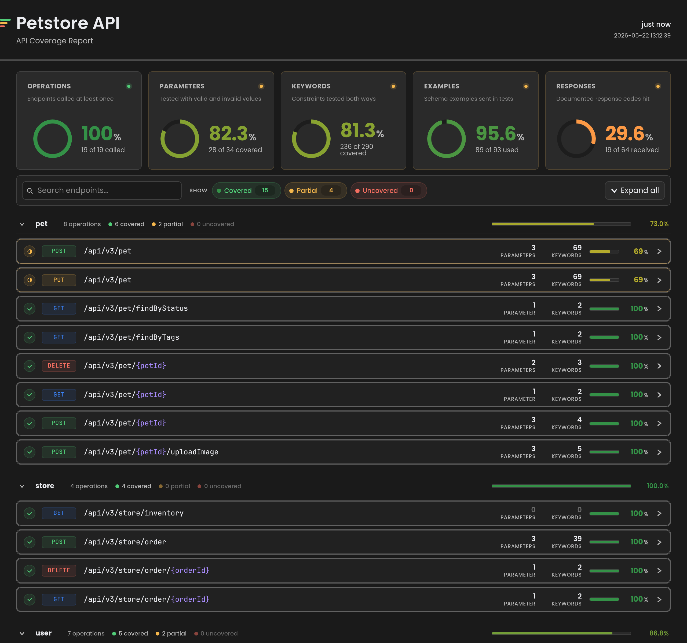

<p align="center">
  
</p>

<h1 align="center">TraceCov</h1>

<p align="center">
  <b>Your tests pass. What did they never touch?</b><br>
  TraceCov shows which parts of your OpenAPI spec your tests never exercise:<br>
  operations, parameters, schema keywords, responses.
</p>

<p align="center">
  <a href="https://tracecov.sh">Website</a> |
  <a href="https://docs.tracecov.sh">Documentation</a> |
  <a href="https://demo.tracecov.sh">Live demo</a> |
  <a href="CHANGELOG.md">Changelog</a>
</p>



## Why

Sending `POST /users` with `{"name": "Alice", "age": 30}` covers the endpoint, but not an empty name, a negative age or a name that is too long. TraceCov tracks the JSON Schema keywords in your spec (`minLength`, `pattern`, `enum`, `minimum`, ...). For each one, the report shows whether your tests sent a value that satisfies it and a value that violates it.

## Install

```bash
# CLI
curl -sL https://cli.tracecov.sh/install/ | sh

# Python
uv pip install tracecov

# JavaScript
npm install @tracecov/core
```

## Quick start

Record two requests to the public Petstore API (needs `requests`):

```python
import requests
import tracecov

spec = requests.get("https://petstore3.swagger.io/api/v3/openapi.json").json()
coverage = tracecov.CoverageMap.from_dict(spec)
session = coverage.requests.track_session(requests.Session())

pet = {"id": 123456, "name": "fluffy", "photoUrls": [], "status": "available"}
session.post("https://petstore3.swagger.io/api/v3/pet", json=pet)
session.get("https://petstore3.swagger.io/api/v3/pet/123456")

coverage.save_report()  # writes coverage.html
```

Your test suite works the same way: send its requests through the tracked session. The [documentation](https://docs.tracecov.sh/integration/) covers pytest, Schemathesis, `httpx`, Django, Flask, `fetch`, `axios` and Playwright.

## What it measures

| Dimension | What it measures |
|---|---|
| Operations | HTTP method + path combinations called |
| Parameters | Path, query, header, cookie and body values |
| Keywords | JSON Schema validation rules (`minLength`, `pattern`, ...), with valid and invalid values |
| Examples | Schema examples and defaults used |
| Responses | HTTP status codes returned |
| Response keywords | Validation rules the returned bodies exercised, and the ones they broke |

## Editions

| | Community | Professional |
|---|:---:|:---:|
| Every coverage dimension above | yes | yes |
| HTML, JSON and Markdown reports, `--fail-under` thresholds | yes | yes |
| Python and JavaScript libraries, CLI `report` | yes | yes |
| HAR, Postman and VCR import | | yes |
| CLI proxy: coverage from a test suite in any language, no code changes | | yes |
| Coverage labels: which test covers each part of the API | | yes |
| Suggested requests for the keywords your tests missed | | yes |
| MCP server for coding agents | | yes |

Community is free for internal use, commercial included, under the [TraceCov Community License](LICENSE). For Professional, write to [info@tracecov.sh](mailto:info@tracecov.sh). Full comparison: [Community vs Professional](https://docs.tracecov.sh/editions/).

## Where to ask what

| You have | Go to |
|---|---|
| A crash, a wrong coverage number, a spec TraceCov rejects | [Open an issue](https://github.com/schemathesis/tracecov/issues/new/choose) |
| A question, an idea, something to show | [Discussions](https://github.com/schemathesis/tracecov/discussions) |
| A security problem | [SECURITY.md](SECURITY.md) |
| Interest in Professional | [info@tracecov.sh](mailto:info@tracecov.sh) |

## About this repository

This repository holds TraceCov's releases, changelog and issue tracker. The source code is not public.
